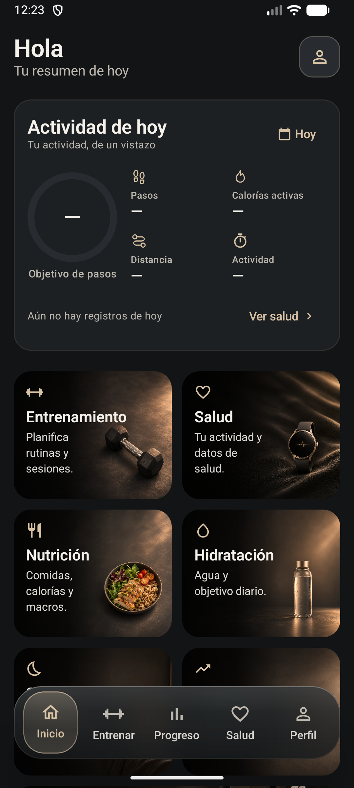

# Entrega visual para Claude Code — 25/11/2026

Paquete preparado y probado sobre fase/f1, base c2c2f324e57fcc297126976970b28896da4f0231. Esta entrega añade propuestas de código y documentación; el código activo en app/ aún no está modificado. Leer docs/12_VISUAL_REFINEMENT.md y docs/CLAUDE_NEXT.md.

- FitnessApp-Mejoras-Visuales.zip: archivo original completo, con ocho archivos fuente, parche, manifiesto, capturas y lint.
- source/: esos ocho archivos disponibles sin extraer el ZIP.
- visual.patch: diff revisable para integrar sobre la base indicada.
- capturas/: Inicio, Perfil y Salud ejecutándose en el emulador; estado vacío real, sin cifras de ejemplo.
- verificacion/: informe lint real; cero errores, 13 advertencias.
- manifest.json: rutas, SHA-256 de archivos propuestos y hashes de los originales locales. El original FitnessCard.kt difiere del remoto solo en saltos de línea; su texto normalizado coincide.
- SHA256SUMS.txt: integridad del ZIP.

El README dentro del ZIP describe el momento previo a la subida: su frase «No se ha subido al repositorio» es histórica. Esta carpeta es la entrega publicada. No incluye APK, datos personales, local.properties ni applicationId de revisión.

[Perfil](capturas/perfil.png) · [Salud](capturas/salud.png)
