# Galería del catálogo visual

Ilustraciones generadas; secuencias de tres posiciones, no vídeos fluidos. [Encargo G2](../../docs/14_EXERCISE_MEDIA_AND_PROGRESS.md).

## CHEST

| Ejercicio | Miniatura | Guía y músculos |
|---|---|---|
| Press banca con barra | 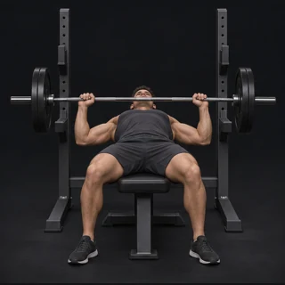 | [Posición 1](chest_barbell_bench_press/frames/01.webp) · [2](chest_barbell_bench_press/frames/02.webp) · [3](chest_barbell_bench_press/frames/03.webp) · [Músculos](chest_barbell_bench_press/anatomy.webp) |
| Press banca con mancuernas | 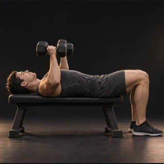 | [Posición 1](chest_dumbbell_bench_press/frames/01.webp) · [2](chest_dumbbell_bench_press/frames/02.webp) · [3](chest_dumbbell_bench_press/frames/03.webp) · [Músculos](chest_dumbbell_bench_press/anatomy.webp) |
| Press inclinado con mancuernas | 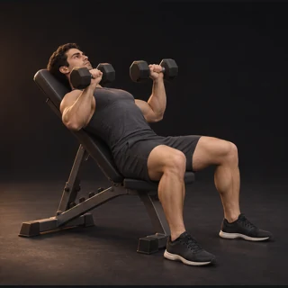 | [Posición 1](chest_incline_dumbbell_press/frames/01.webp) · [2](chest_incline_dumbbell_press/frames/02.webp) · [3](chest_incline_dumbbell_press/frames/03.webp) · [Músculos](chest_incline_dumbbell_press/anatomy.webp) |
| Aperturas en máquina | 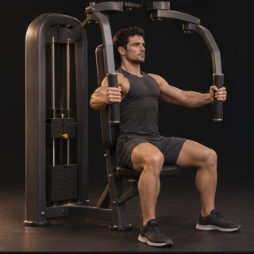 | [Posición 1](chest_machine_fly/frames/01.webp) · [2](chest_machine_fly/frames/02.webp) · [3](chest_machine_fly/frames/03.webp) · [Músculos](chest_machine_fly/anatomy.webp) |
| Flexiones | 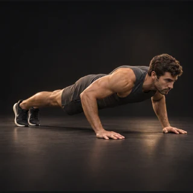 | [Posición 1](chest_push_up/frames/01.webp) · [2](chest_push_up/frames/02.webp) · [3](chest_push_up/frames/03.webp) · [Músculos](chest_push_up/anatomy.webp) |

## BACK

| Ejercicio | Miniatura | Guía y músculos |
|---|---|---|
| Jalón al pecho | 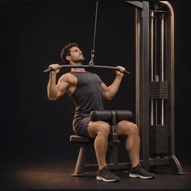 | [Posición 1](back_lat_pulldown/frames/01.webp) · [2](back_lat_pulldown/frames/02.webp) · [3](back_lat_pulldown/frames/03.webp) · [Músculos](back_lat_pulldown/anatomy.webp) |
| Remo sentado en polea | 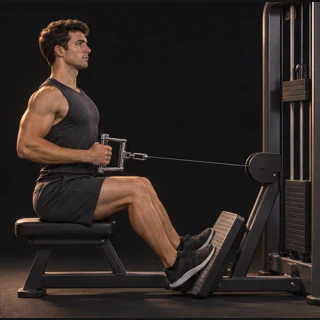 | [Posición 1](back_seated_cable_row/frames/01.webp) · [2](back_seated_cable_row/frames/02.webp) · [3](back_seated_cable_row/frames/03.webp) · [Músculos](back_seated_cable_row/anatomy.webp) |
| Remo con mancuerna | 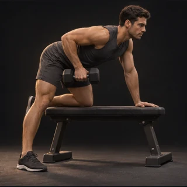 | [Posición 1](back_one_arm_dumbbell_row/frames/01.webp) · [2](back_one_arm_dumbbell_row/frames/02.webp) · [3](back_one_arm_dumbbell_row/frames/03.webp) · [Músculos](back_one_arm_dumbbell_row/anatomy.webp) |
| Dominada asistida | 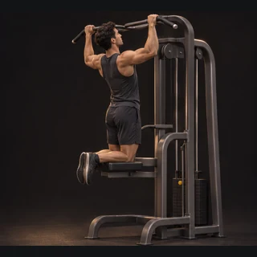 | [Posición 1](back_assisted_pull_up/frames/01.webp) · [2](back_assisted_pull_up/frames/02.webp) · [3](back_assisted_pull_up/frames/03.webp) · [Músculos](back_assisted_pull_up/anatomy.webp) |
| Remo con apoyo de pecho | 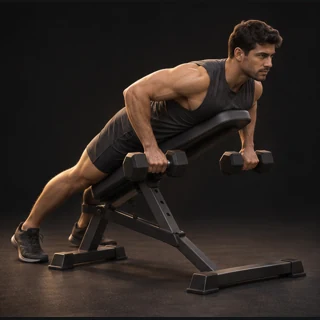 | [Posición 1](back_chest_supported_row/frames/01.webp) · [2](back_chest_supported_row/frames/02.webp) · [3](back_chest_supported_row/frames/03.webp) · [Músculos](back_chest_supported_row/anatomy.webp) |

## SHOULDERS

| Ejercicio | Miniatura | Guía y músculos |
|---|---|---|
| Press sentado con mancuernas | 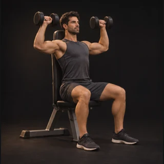 | [Posición 1](shoulders_seated_dumbbell_press/frames/01.webp) · [2](shoulders_seated_dumbbell_press/frames/02.webp) · [3](shoulders_seated_dumbbell_press/frames/03.webp) · [Músculos](shoulders_seated_dumbbell_press/anatomy.webp) |
| Elevaciones laterales | 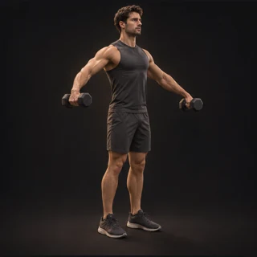 | [Posición 1](shoulders_dumbbell_lateral_raise/frames/01.webp) · [2](shoulders_dumbbell_lateral_raise/frames/02.webp) · [3](shoulders_dumbbell_lateral_raise/frames/03.webp) · [Músculos](shoulders_dumbbell_lateral_raise/anatomy.webp) |
| Elevaciones laterales en polea | 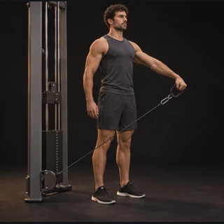 | [Posición 1](shoulders_cable_lateral_raise/frames/01.webp) · [2](shoulders_cable_lateral_raise/frames/02.webp) · [3](shoulders_cable_lateral_raise/frames/03.webp) · [Músculos](shoulders_cable_lateral_raise/anatomy.webp) |
| Pájaros con mancuernas | 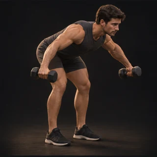 | [Posición 1](shoulders_dumbbell_rear_delt_fly/frames/01.webp) · [2](shoulders_dumbbell_rear_delt_fly/frames/02.webp) · [3](shoulders_dumbbell_rear_delt_fly/frames/03.webp) · [Músculos](shoulders_dumbbell_rear_delt_fly/anatomy.webp) |
| Aperturas inversas en máquina | 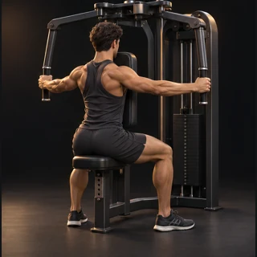 | [Posición 1](shoulders_reverse_machine_fly/frames/01.webp) · [2](shoulders_reverse_machine_fly/frames/02.webp) · [3](shoulders_reverse_machine_fly/frames/03.webp) · [Músculos](shoulders_reverse_machine_fly/anatomy.webp) |

## BICEPS

| Ejercicio | Miniatura | Guía y músculos |
|---|---|---|
| Curl con mancuernas | 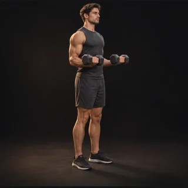 | [Posición 1](biceps_dumbbell_curl/frames/01.webp) · [2](biceps_dumbbell_curl/frames/02.webp) · [3](biceps_dumbbell_curl/frames/03.webp) · [Músculos](biceps_dumbbell_curl/anatomy.webp) |
| Curl con barra EZ | 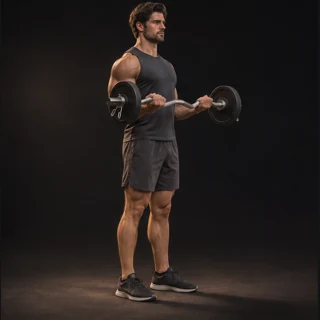 | [Posición 1](biceps_ez_bar_curl/frames/01.webp) · [2](biceps_ez_bar_curl/frames/02.webp) · [3](biceps_ez_bar_curl/frames/03.webp) · [Músculos](biceps_ez_bar_curl/anatomy.webp) |
| Curl martillo | 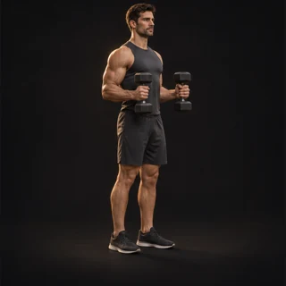 | [Posición 1](biceps_hammer_curl/frames/01.webp) · [2](biceps_hammer_curl/frames/02.webp) · [3](biceps_hammer_curl/frames/03.webp) · [Músculos](biceps_hammer_curl/anatomy.webp) |
| Curl en polea | 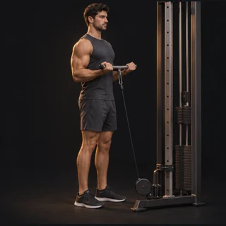 | [Posición 1](biceps_cable_curl/frames/01.webp) · [2](biceps_cable_curl/frames/02.webp) · [3](biceps_cable_curl/frames/03.webp) · [Músculos](biceps_cable_curl/anatomy.webp) |
| Curl predicador | 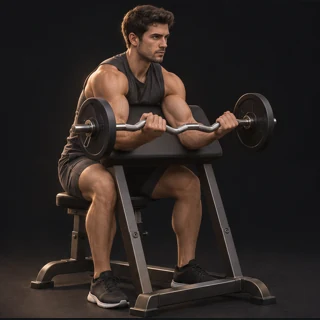 | [Posición 1](biceps_preacher_curl/frames/01.webp) · [2](biceps_preacher_curl/frames/02.webp) · [3](biceps_preacher_curl/frames/03.webp) · [Músculos](biceps_preacher_curl/anatomy.webp) |

## TRICEPS

| Ejercicio | Miniatura | Guía y músculos |
|---|---|---|
| Extensión en polea con cuerda | 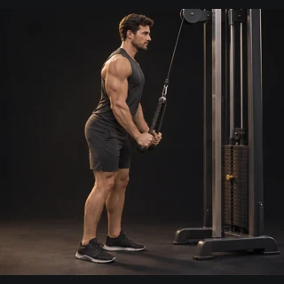 | [Posición 1](triceps_rope_pushdown/frames/01.webp) · [2](triceps_rope_pushdown/frames/02.webp) · [3](triceps_rope_pushdown/frames/03.webp) · [Músculos](triceps_rope_pushdown/anatomy.webp) |
| Extensión en polea con barra | 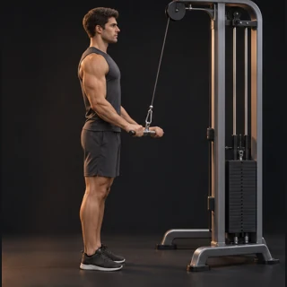 | [Posición 1](triceps_bar_pushdown/frames/01.webp) · [2](triceps_bar_pushdown/frames/02.webp) · [3](triceps_bar_pushdown/frames/03.webp) · [Músculos](triceps_bar_pushdown/anatomy.webp) |
| Extensión por encima de la cabeza en polea | 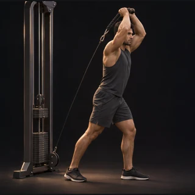 | [Posición 1](triceps_cable_overhead_extension/frames/01.webp) · [2](triceps_cable_overhead_extension/frames/02.webp) · [3](triceps_cable_overhead_extension/frames/03.webp) · [Músculos](triceps_cable_overhead_extension/anatomy.webp) |
| Extensión tumbado con barra EZ | 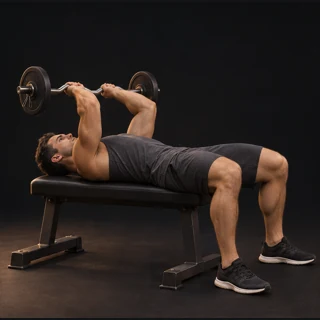 | [Posición 1](triceps_ez_skull_crusher/frames/01.webp) · [2](triceps_ez_skull_crusher/frames/02.webp) · [3](triceps_ez_skull_crusher/frames/03.webp) · [Músculos](triceps_ez_skull_crusher/anatomy.webp) |
| Extensión unilateral con mancuerna | 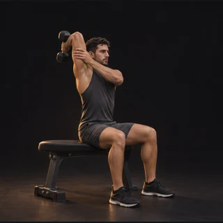 | [Posición 1](triceps_one_arm_dumbbell_extension/frames/01.webp) · [2](triceps_one_arm_dumbbell_extension/frames/02.webp) · [3](triceps_one_arm_dumbbell_extension/frames/03.webp) · [Músculos](triceps_one_arm_dumbbell_extension/anatomy.webp) |

## QUADS

| Ejercicio | Miniatura | Guía y músculos |
|---|---|---|
| Sentadilla goblet | 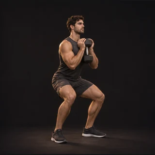 | [Posición 1](quads_goblet_squat/frames/01.webp) · [2](quads_goblet_squat/frames/02.webp) · [3](quads_goblet_squat/frames/03.webp) · [Músculos](quads_goblet_squat/anatomy.webp) |
| Sentadilla con barra | 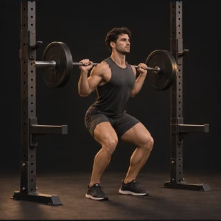 | [Posición 1](quads_barbell_back_squat/frames/01.webp) · [2](quads_barbell_back_squat/frames/02.webp) · [3](quads_barbell_back_squat/frames/03.webp) · [Músculos](quads_barbell_back_squat/anatomy.webp) |
| Prensa de piernas | 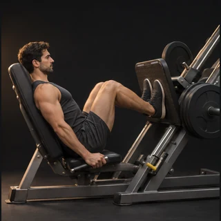 | [Posición 1](quads_leg_press/frames/01.webp) · [2](quads_leg_press/frames/02.webp) · [3](quads_leg_press/frames/03.webp) · [Músculos](quads_leg_press/anatomy.webp) |
| Extensión de rodilla en máquina | 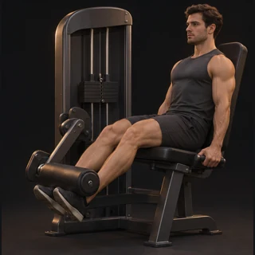 | [Posición 1](quads_leg_extension/frames/01.webp) · [2](quads_leg_extension/frames/02.webp) · [3](quads_leg_extension/frames/03.webp) · [Músculos](quads_leg_extension/anatomy.webp) |
| Sentadilla dividida | 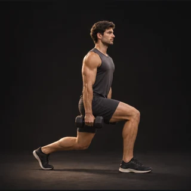 | [Posición 1](quads_split_squat/frames/01.webp) · [2](quads_split_squat/frames/02.webp) · [3](quads_split_squat/frames/03.webp) · [Músculos](quads_split_squat/anatomy.webp) |

## HAMSTRINGS

| Ejercicio | Miniatura | Guía y músculos |
|---|---|---|
| Curl femoral sentado | 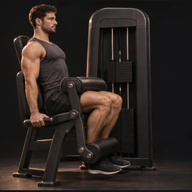 | [Posición 1](hamstrings_seated_leg_curl/frames/01.webp) · [2](hamstrings_seated_leg_curl/frames/02.webp) · [3](hamstrings_seated_leg_curl/frames/03.webp) · [Músculos](hamstrings_seated_leg_curl/anatomy.webp) |
| Curl femoral tumbado | 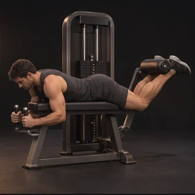 | [Posición 1](hamstrings_lying_leg_curl/frames/01.webp) · [2](hamstrings_lying_leg_curl/frames/02.webp) · [3](hamstrings_lying_leg_curl/frames/03.webp) · [Músculos](hamstrings_lying_leg_curl/anatomy.webp) |
| Peso muerto rumano con barra | 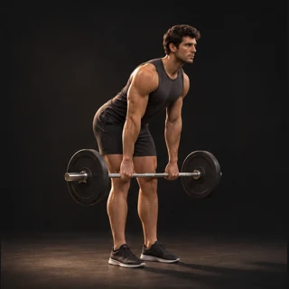 | [Posición 1](hamstrings_barbell_romanian_deadlift/frames/01.webp) · [2](hamstrings_barbell_romanian_deadlift/frames/02.webp) · [3](hamstrings_barbell_romanian_deadlift/frames/03.webp) · [Músculos](hamstrings_barbell_romanian_deadlift/anatomy.webp) |
| Peso muerto rumano con mancuernas | 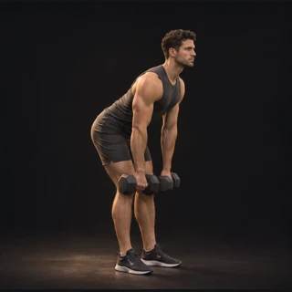 | [Posición 1](hamstrings_dumbbell_romanian_deadlift/frames/01.webp) · [2](hamstrings_dumbbell_romanian_deadlift/frames/02.webp) · [3](hamstrings_dumbbell_romanian_deadlift/frames/03.webp) · [Músculos](hamstrings_dumbbell_romanian_deadlift/anatomy.webp) |
| Curl femoral con deslizadores | 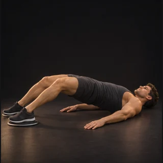 | [Posición 1](hamstrings_slider_leg_curl/frames/01.webp) · [2](hamstrings_slider_leg_curl/frames/02.webp) · [3](hamstrings_slider_leg_curl/frames/03.webp) · [Músculos](hamstrings_slider_leg_curl/anatomy.webp) |

## GLUTES

| Ejercicio | Miniatura | Guía y músculos |
|---|---|---|
| Hip thrust con barra | 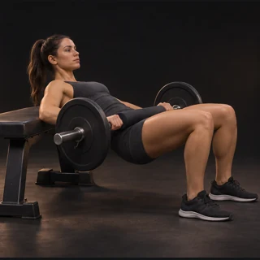 | [Posición 1](glutes_barbell_hip_thrust/frames/01.webp) · [2](glutes_barbell_hip_thrust/frames/02.webp) · [3](glutes_barbell_hip_thrust/frames/03.webp) · [Músculos](glutes_barbell_hip_thrust/anatomy.webp) |
| Puente de glúteos | 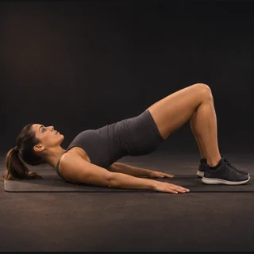 | [Posición 1](glutes_bridge/frames/01.webp) · [2](glutes_bridge/frames/02.webp) · [3](glutes_bridge/frames/03.webp) · [Músculos](glutes_bridge/anatomy.webp) |
| Patada en polea | 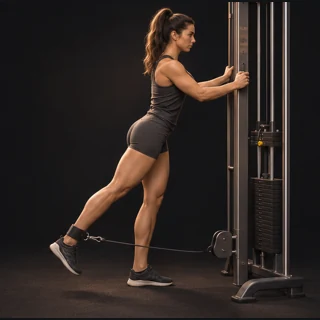 | [Posición 1](glutes_cable_kickback/frames/01.webp) · [2](glutes_cable_kickback/frames/02.webp) · [3](glutes_cable_kickback/frames/03.webp) · [Músculos](glutes_cable_kickback/anatomy.webp) |
| Abducción en máquina | 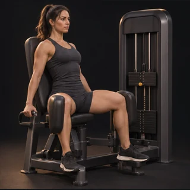 | [Posición 1](glutes_machine_hip_abduction/frames/01.webp) · [2](glutes_machine_hip_abduction/frames/02.webp) · [3](glutes_machine_hip_abduction/frames/03.webp) · [Músculos](glutes_machine_hip_abduction/anatomy.webp) |
| Subida al banco | 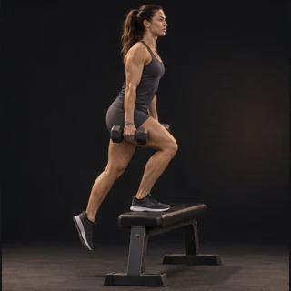 | [Posición 1](glutes_step_up/frames/01.webp) · [2](glutes_step_up/frames/02.webp) · [3](glutes_step_up/frames/03.webp) · [Músculos](glutes_step_up/anatomy.webp) |

## CALVES

| Ejercicio | Miniatura | Guía y músculos |
|---|---|---|
| Elevaciones de talón de pie | 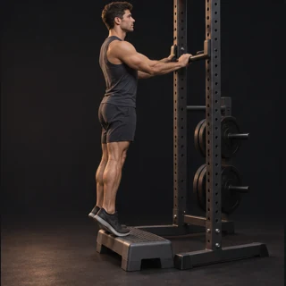 | [Posición 1](calves_standing_raise/frames/01.webp) · [2](calves_standing_raise/frames/02.webp) · [3](calves_standing_raise/frames/03.webp) · [Músculos](calves_standing_raise/anatomy.webp) |
| Elevaciones sentado en máquina | 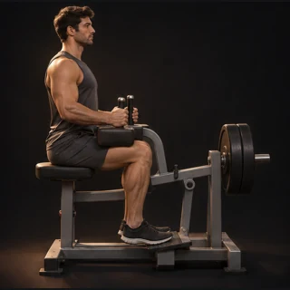 | [Posición 1](calves_seated_machine_raise/frames/01.webp) · [2](calves_seated_machine_raise/frames/02.webp) · [3](calves_seated_machine_raise/frames/03.webp) · [Músculos](calves_seated_machine_raise/anatomy.webp) |
| Elevaciones en prensa | 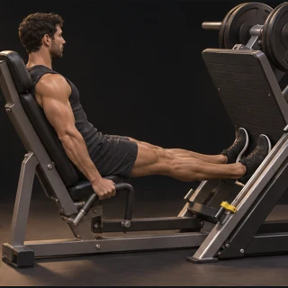 | [Posición 1](calves_leg_press_raise/frames/01.webp) · [2](calves_leg_press_raise/frames/02.webp) · [3](calves_leg_press_raise/frames/03.webp) · [Músculos](calves_leg_press_raise/anatomy.webp) |
| Elevación unilateral con peso corporal | 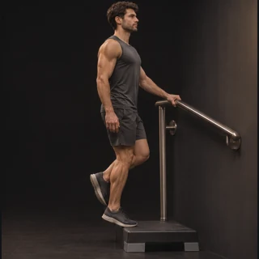 | [Posición 1](calves_single_leg_bodyweight_raise/frames/01.webp) · [2](calves_single_leg_bodyweight_raise/frames/02.webp) · [3](calves_single_leg_bodyweight_raise/frames/03.webp) · [Músculos](calves_single_leg_bodyweight_raise/anatomy.webp) |
| Elevaciones de pie en máquina | 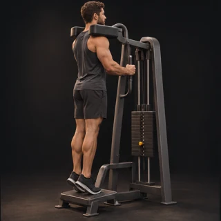 | [Posición 1](calves_standing_machine_raise/frames/01.webp) · [2](calves_standing_machine_raise/frames/02.webp) · [3](calves_standing_machine_raise/frames/03.webp) · [Músculos](calves_standing_machine_raise/anatomy.webp) |

## CORE

| Ejercicio | Miniatura | Guía y músculos |
|---|---|---|
| Crunch en colchoneta | 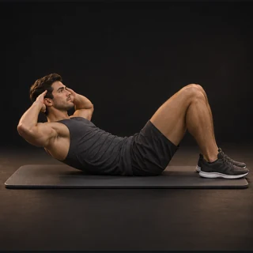 | [Posición 1](core_mat_crunch/frames/01.webp) · [2](core_mat_crunch/frames/02.webp) · [3](core_mat_crunch/frames/03.webp) · [Músculos](core_mat_crunch/anatomy.webp) |
| Crunch en polea | 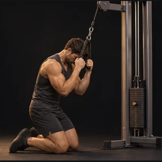 | [Posición 1](core_cable_crunch/frames/01.webp) · [2](core_cable_crunch/frames/02.webp) · [3](core_cable_crunch/frames/03.webp) · [Músculos](core_cable_crunch/anatomy.webp) |
| Crunch en máquina | 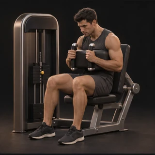 | [Posición 1](core_machine_crunch/frames/01.webp) · [2](core_machine_crunch/frames/02.webp) · [3](core_machine_crunch/frames/03.webp) · [Músculos](core_machine_crunch/anatomy.webp) |
| Crunch inverso | 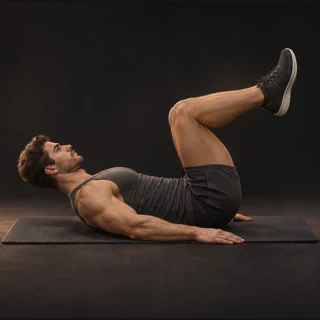 | [Posición 1](core_reverse_crunch/frames/01.webp) · [2](core_reverse_crunch/frames/02.webp) · [3](core_reverse_crunch/frames/03.webp) · [Músculos](core_reverse_crunch/anatomy.webp) |
| Crunch en fitball | 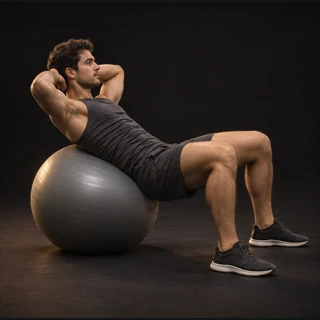 | [Posición 1](core_stability_ball_crunch/frames/01.webp) · [2](core_stability_ball_crunch/frames/02.webp) · [3](core_stability_ball_crunch/frames/03.webp) · [Músculos](core_stability_ball_crunch/anatomy.webp) |
