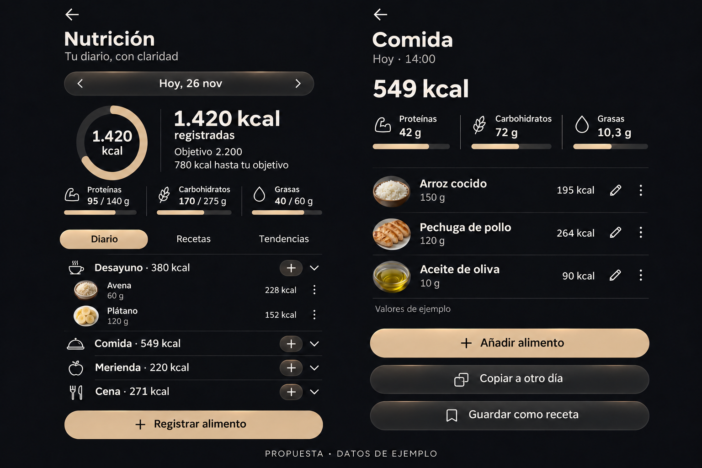
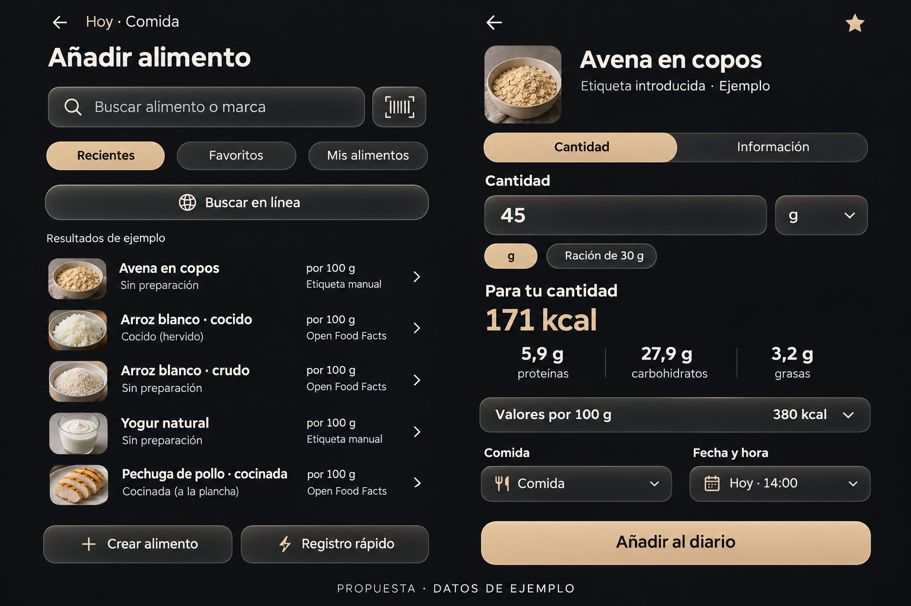
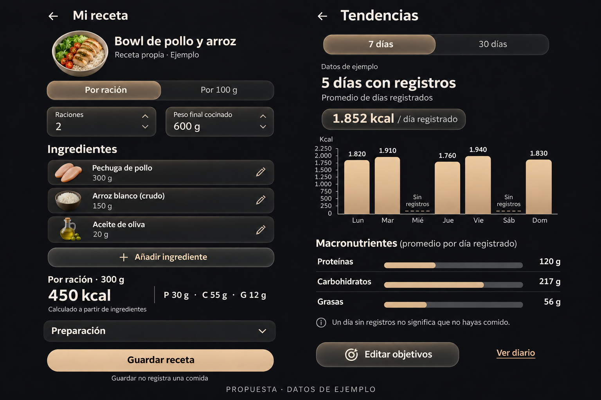

# Nutrición: paquete de producto y diseño

Plan completo para ampliar el registro manual actual. Base revisada `cae2db1`, Room v5. Esta entrega contiene documentos y tres láminas originales con seis vistas: **todavía no modifica app/**.

## Leer e implementar

1. [Documento maestro](../../docs/16_NUTRITION_MASTER.md).
2. [UX y diseño](../../docs/nutrition/01_UX_AND_DESIGN.md).
3. [Datos e integración](../../docs/nutrition/02_DATA_AND_INTEGRATION.md).
4. [Roadmap y aceptación](../../docs/nutrition/03_ROADMAP_AND_ACCEPTANCE.md).
5. [Investigación y fuentes](../../docs/nutrition/04_RESEARCH_AND_SOURCES.md).
6. [Encargo actual para Claude](../../docs/CLAUDE_NEXT.md).

## Referencias visuales

### Diario y comida

### Buscar y elegir cantidad

### Receta y tendencias

El diseño conserva Titanium Champagne y el Liquid Glass abierto: datos sobre el fondo, cristal en controles. **Todas las cifras y objetivos son ejemplos gráficos**, no alimentos curados ni una dieta recomendada. Las fotos son ilustrativas y sus marcas de fuente no implican que esos productos se hayan consultado realmente. No copiar valores a producción. Las imágenes sirven para composición y estilo; el cálculo y la cobertura siguen los contratos de datos y los fixtures sintéticos, que tampoco se distribuyen como alimentos reales.

Los PNG y sus prompts existen en references/. La revisión numérica tiene prompts revision2 donde corresponde. manifest.json contiene rutas/dimensiones/hashes; audit.json verifica entrega y aritmética de fixtures. No se necesitan nuevos raster de producción para construir estas pantallas: usar controles Compose, iconos existentes y fallback neutro para alimentos sin foto; imágenes de usuario/proveedor solo con origen real.

Alcance del próximo trabajo: N1 diario/alimentos propios, N2 productos/código de barras reales y N3 recetas/objetivos/tendencias. Planificador, IA/foto/voz y backend quedan fuera del primer lote. Las integraciones externas conservan sus requisitos reales y su alternativa manual; no se entrega aquí una base nutricional inventada ni acceso privado a Fitia.
