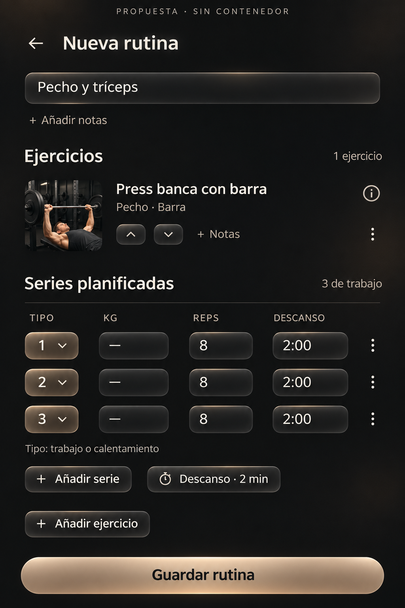

# Editor de rutinas: Liquid Glass sin contenedor

Diseño aprobado por el usuario. Referencia generada mediante la herramienta integrada de imágenes; es una propuesta, no una captura de la app implementada.

Aplicar docs/15_OPEN_GLASS_ROUTINE_EDITOR.md. Esta es la versión SIN tarjeta exterior. Las propuestas anteriores con tarjeta quedan descartadas para este editor. No poner la leyenda superior «PROPUESTA · SIN CONTENEDOR» en la app ni usar el mockup como fondo.

Usar las miniaturas reales ya disponibles por catalogId; la imagen de ejemplo no sustituye los recursos runtime. Los valores y nombre del mockup son ejemplos, no datos a precargar.
